# How the knowledge-base pipeline works

Source-correction release verified at 2026-10-16 22:44 EEST: 297 Python/nine Node tests, Ruff, all validators and zero-diagnostic Astro build (635 pages). Rotation source/text correction is applied and archived; current coverage147/377 supported,230pending. This implements the guarded application capability described below, not full-audit completion.

Owned-source repairs (2026-10-16 22:41 EEST): `apply-published-repairs` supports the explicit `owned_source_correction` scope with a typed list of evidence IDs and replacement spoken `source` records. The application validates them against the fresh eligible corpus snapshot and actual captions: same original video, unique approved evidence/segment IDs, exact caption envelope, canonical URL, duration and gap limits. Its identity binds original freshness, the corrections, the complete corrected dossier and policy versions; a new complete primary review must match that identity/plan hash. All dependent units are checked against corrected owned proof. Canonical matching uses original records, post-application audit mapping uses the verified new source, and original full content plus source corrections are archived through the existing recoverable transaction. Visual metadata is preserved. Ordinary repairs remain compatible; this does not approve a source proposal or waive semantic review. The first guarded rotation repair moves coverage to147/377 supported,230pending; full release is running under P1-51.

Repair policy update (2026-10-16 22:10 EEST): draft 1.1.1 / verification 1.1.2 distinguish the source-grounded subject from an erroneous heading. Supported corrections or narrowings may fix that heading; supported same-subject evidence must not be quarantined merely for contradicting it. Concept/evidence IDs and slugs are opaque references and may contain obsolete labels, so they cannot prove topic identity. Actual selected-caption ownership, missing-referent uncertainty, genuine different-topic quarantine and complete primary/independent review remain mandatory. Reducer assembly preserves proposed corrections without treating chunk proposals as proof. Policy versions invalidate affected pending plans; already-cleared unchanged audit decisions are not reset. Three real Luna/high heading/ID controls passed after fresh primary review and a flick-scope correction; an invented footwork instruction was independently rejected and removed. These bounded controls support the fix, not whole-corpus accuracy certification. Current full-audit checkpoint: 146/377 articles supported, 231 pending; P1-34/P1-51 remain open.

Published repair checkpoint (2026-10-15 11:00 EEST): 377 eligible articles / 4,501 units; 23 supported / 354 pending articles; 176 supported / 4,325 pending units; two excluded originals retained. Ten additional articles repaired after primary review and real separate verification. Repair contract 1.0.8 omits old confidence/approval from independent evidence/relation verifier targets, preserving knowledge text, source/visual fields, owned IDs and quarantine dispositions; complete proposed objects remain available for deterministic application checks. The ordinary release gate passed at 10:58 EEST: reviewed/published validation, 203 Python tests, nine monitor tests, Ruff, zero Astro errors/warnings/hints and 635 built pages. The [workflow](full-published-audit-workflow-2026-10-14.md) and [continuation record](automated-published-repair-study-2026-10-14.md#full-audit-continuation--2026-10-15) retain strict completion requirements. The large-rhythm exception and frozen accuracy evaluation remain open; normal processing stays paused.

Large-article reduction assembles untrusted chunk proposals rather than judging empty transcript input. Final verification receives actual selected captions, with no draft verdict/confidence. Bounded uncertain nonvisual proposals receive that check; oversized source proofs and unwatched visual claims remain unresolved. Repair contract 1.1.0 separates draft/verification policy versions and reuses only matching stage/unit results with provenance; legacy stage digests require one refresh. Failed-unit revisions retain unaffected proposals. Exact claim/source/topic/target/context/model/policy/primary-finding dependencies guard verifier reuse; changed article fields conservatively reopen checks. The compact wire shares source spans without removing owned IDs or selected text/timing. Unchanged exceptions stay parked. See [operations](operations.md#audit-efficiency-follow-up) for invalidation and model-accuracy limits. Verifier article fields mirror the proposed values; the old topic is separately labeled editorial context, never claim proof or the result to assess. Quarantined records are verified with their proposed unreviewed status, matching application.

Confirmed primary needs-fix notes are also repair inputs: changing them invalidates the private plan/cache and blocks applying an older verified result. The constrained response enforces one edit per article field and mutually exclusive quarantine versus rewriting; runtime checks remain mandatory.

The model wire response requires every unit as a named property, preventing array-length checks from admitting duplicate/missing keys. It is normalized to the existing typed list/checkpoint format; identity, coverage and source-ID validation remain mandatory.

This project is a **local, operator-run publishing pipeline**, not a website that scrapes YouTube at request time. Python commands collect and transform source material on the maintainer's computer; Codex CLI proposes structured knowledge; reviewed YAML is the editorial source of truth; Astro builds a read-only static site for GitHub Pages.

## What is automated and what is manual

| Stage | Automated by the repository | Operator or reviewer responsibility |
|---|---|---|
| Source discovery | `yt-dlp` lists channel or playlist videos. `run-cp.py` can continue automatically from unseen discovery entries after configured batch entries are exhausted. | Define enabled source policy and audit exclusions; `sources.yaml` video entries are configured batch history, not an exhaustive catalog or the current run selection. |
| Ingestion | Python fetches metadata and available timed captions and assigns stable segment IDs. | Supply video URLs, choose transcript languages, and investigate unavailable/member-only videos. |
| Knowledge extraction | The processor invokes `codex exec` with the transcript, taxonomy, known concepts, and a strict output schema. | Authenticate Codex, choose the configured model, and rerun failed jobs. |
| LLM budget | A private daily token ledger reserves an estimate before each extraction, rephrase, or benchmark call and records reported usage afterward. Exhausted daily or task caps defer work before subprocess execution. | Adjust `llm_budget` in `config/processors.yaml`, inspect `llm-budget --kb <id>`, and decide when deferred work should resume. |
| Candidate resolution | `process-pending` sends bounded transcript context, the candidate, and a short existing-concept list to schema-constrained Codex CLI. Deterministic validators then enforce segment, span, taxonomy, time, and provenance invariants before canonical writes. | Optionally add editorial advice or an explicit override. Human input is an augmentation, not the default queue. |
| Spoken evidence | Validation checks every approved claim against real transcript segment IDs and canonical YouTube timestamps. | Check that the excerpt supports the editorial wording. |
| Moment boundaries | `report-boundaries` derives caption-only sentence-like units, measures mid-sentence/short windows, and proposes snapped bounds without changing reviewed YAML. `process-pending` defers flagged new candidates. | Review merge, context, split, or defer actions; never treat a proposed playback boundary as new claim support without review. |
| Excerpt safety | The deterministic overlap screen flags complete/high-ratio transcript matches; `rephrase-excerpts` or `publish --auto-rephrase-high-overlap` asks the configured low-cost Codex model for an editorial summary and verifies that the rewrite no longer has high overlap. | Review the rewrite when it changes a canonical excerpt; the source metadata and cited timestamps remain unchanged. |
| Concept evidence essays | `build-evidence-summaries --kb <id> --engine deterministic --write` provides a no-cost fallback; `--engine codex --write --refresh-generated` batches approved evidence reasons through the configured low-cost Codex model and daily `summary` budget to produce coherent 2–4 sentence prose. Generated summaries carry an `evidence_summary_source_hash` and `evidence_summary_generator`; `publish` refreshes deterministic summaries only, while Codex summaries are refreshed explicitly when new evidence arrives. | Review generated paragraphs as canonical editorial content. The Codex prompt and validator require direct synthesis without source-reporting language, transcript quotation, bullets, or unsupported claims. Hand-authored summaries without a source hash remain untouched. |
| Visual examples | The data model stores a `visual_source` separately from the spoken `source`. | Locate a nearby movement demonstration, set its window and selection method, and eventually mark it manually verified. This is currently reviewer-assisted, not a finished automatic processor. |
| Publishing | Python validates and sanitizes the reviewed corpus, then copies only allowlisted data into the Astro public folder. | Run the publish command after review. |
| Site build | Astro generates static concept, video, search, and KB pages. | Preview locally and deploy the generated site through GitHub Pages. |

The repeatable unattended path is `scripts/run-cp.py --kb <id>`. It rebuilds the private full-inventory ledger, records the exact videos selected for the run, and drains missing extraction, up to ten unclear candidates ready for another automatic check, then due transcript acquisition. It discovers enabled sources only when all three worksets are empty, so catalog expansion cannot outrank cached processing. View count orders otherwise-equal acquisition work but cannot permanently exclude an eligible video. `sources.yaml` remains batch-history provenance; it is not the live boundary. The same entry point is used by the Windows 21:00 scheduled task and by the local monitor at `http://127.0.0.1:4322/`.

The ledger lives at `data/manifests/<kb>/inventory-ledger.json` and is gitignored. It contains no transcript text. A video is complete only after allowed source captions are normalized, current schema-valid candidates exist, every candidate has a final accepted or rejected Codex decision, and accepted citations are incorporated into canonical YAML. Pending and deferred states remain automated work; optional human advice does not define completion.

Every durable inventory write also records an observation in the private `bucket-history.json` beside the ledger. This includes unchanged counts so the monitor can draw flat observed periods without waiting for a bucket change. The writer follows the existing per-KB inventory mutation ownership and atomic replacement; history failures warn without blocking the processing result. The monitor only reads and reloads history, so browser polling and monitor uptime do not control scheduled-run coverage. Retention keeps seven days plus one older boundary observation, capped at 1,000 samples preserving time endpoints. Graphs use actual timestamps and label missing coverage; latest-manifest before/after observations can be recovered with their original times, but unrecorded days are never backfilled from present counts.

The orchestrator streams each child stage's output as it arrives and bounds stage execution after process-tree-safe cleanup: the processor workload uses Windows idle CPU priority, discovery stages have a 20-minute limit, ingestion and other stages have a 45-minute limit, and each ten-candidate semantic-adjudication stage has a 60-minute limit. Each stage prints its `Stage x/y` position and purpose, emits a privacy-safe heartbeat every 15 seconds when no child output arrives, and records its elapsed duration when it finishes, so a quiet log means the stage is still active rather than invisible. The monitor service/UI remains normal priority so controls stay responsive. A timeout exits with code 124 and records `exit_class: timeout`; the monitor Stop control uses Windows process-tree termination so nested yt-dlp/Python workers do not survive a sleep/resume interruption. Within semantic adjudication, a single Codex call that reaches the five-minute per-call timeout is recorded as a private failure and deferred for retry; it does not abort the remaining candidates in that batch. Automatic adjudication stages select and process at most 10 candidates. Progress also reports the eligible candidates inside the selected video pool and the full adjudication backlog, including pending and deferred proposals admitted to the pass, so the ten-item pass is not confused with the larger backlog. The queue and changed concept documents are atomically checkpointed after every 10 completed candidates, limiting timeout loss to the current partial checkpoint.

## Study-to-backlog documentation contract

An analysis or study is not complete when its Markdown report is written. The result must be carried through the planning and operator surfaces:

1. Record each actionable finding in `docs/prioritized-backlog-2026-07-15.md` with a priority, status, source study, dependencies, and acceptance criteria. Group related work under the appropriate feature workstream used by the local backlog page.
2. Rebuild the Astro site locally so `/backlog/` renders the updated Markdown source. Verify that the feature summary, item status, and links are present; do not hand-edit generated HTML.
3. Update the relevant operational documentation (`docs/pipeline.md`, `docs/operations.md`, README, or a domain/legal/content findings report) so the recommended process and the backlog item do not diverge.
4. Add a dated entry to the session log and session notes, including the study-to-backlog IDs and verification performed.

### Navigation placement safety

The atlas is editorial structure, not a keyword index. Automatic placement may place a generated concept only when its lexical match to one navigation node is strong and clearly better than the runner-up; weak or near-tied matches go to the configured `editorial-placement-review` holding node for explicit review. The match uses the label, aliases, definition, facets, evidence summary, and evidence excerpt/reason text, so a newly accepted concept does not depend on a later summary-refresh stage. This prevents words such as “loop,” “push,” or “serve” in a definition from silently selecting the wrong deep branch while keeping navigation validation complete. The intended contract is that `validate` requires every approved concept to have an editorial placement decision; the 2026-08-12 audit found an exemption for automatically generated concepts, which is tracked under P1-32.

## Codex-first semantic-accuracy gate — 2026-08-12

The previous confidence/fuzzy-match promotion path is retired. Extraction now uses the configured 80-segment jobs with eight-segment overlap. `process-pending` uses Codex CLI to decide semantic support and rewrites the public reason/excerpt to one selected span; deterministic code refuses dispersed selections, inconsistent resolution states, out-of-vocabulary facets, incomplete source envelopes, and invented segment IDs.

Legacy heuristic output is preserved as private canonical/queue history but is marked unreviewed: 4,775 evidence moments and 460 concepts are excluded from the public corpus until Codex re-adjudicates their proposals. Human input remains available as optional advice or an explicit override. See [the 2026-08-12 whole-project review](project-review-2026-08-12-11.md) and the completed mechanisms plus remaining drain work in the [prioritized backlog](prioritized-backlog-2026-07-15.md).

The Markdown backlog remains the planning source of truth. The HTML backlog is a generated local operator view and is intentionally excluded from the public GitHub Pages build.

## Data flow

```mermaid
flowchart LR
    Y["YouTube channels and videos"] --> D["discover"]
    D --> M["reviewable video manifest"]
    M --> I["ingest selected URLs"]
    I --> N["local normalized metadata and timed transcripts"]
    N --> C["Codex CLI structured extraction"]
    C --> Q["local candidate files and review queue"]
    Q --> C2["Codex semantic adjudication"]
    C2 --> R["validated canonical YAML"]
    H["optional human advice or override"] -.-> R
    R --> E["high-overlap excerpt guard"]
    E --> V["validate and publish"]
    V --> P["sanitized public corpus"]
    P --> A["Astro static build"]
    A --> G["GitHub Pages"]
```



The raw/normalized transcripts, Codex responses, review media, and offline archives are gitignored. The browser receives only the sanitized corpus under `app/public/data/`.

Codex deferrals remain automated adjudication work; they are not assigned to a person after an arbitrary check count. Extraction, adjudication, and acquisition batches rotate fairly across sources while retaining view-count priority within each source. The local `/human-review/` workspace remains available for optional advice or an explicit audited override. Canonical writes are blocked while another processor child is active.

## Normal operating sequence

Run commands from the repository root with the virtual environment active. Every command accepts `--kb`, so the same pipeline can operate independent knowledge bases.

### 1. Discover a channel

```powershell
python -m processors.cli discover https://www.youtube.com/@GlobalTTStudio --kb table-tennis
```

This writes a local discovery manifest. Discovery does not ingest transcripts or publish anything.

### 2. Ingest videos manually or through the videos selected for a run

For a deliberate one-off configured batch, record its provenance in `config/kbs/<kb>/sources.yaml` and pass the public URLs to ingestion. This is not required for discovery-continuation videos selected automatically by `run-cp.py`:

```powershell
python -m processors.cli ingest --kb table-tennis `
  https://www.youtube.com/watch?v=VIDEO_ID_1 `
  https://www.youtube.com/watch?v=VIDEO_ID_2
```

`processors/ingest.py` uses `yt-dlp` for video metadata and a cache-first adapter chain for timed captions. It writes one private normalized JSON document per video under `data/normalized/<kb>/`. Each caption receives an ID such as `VIDEO_ID:00042`; later evidence cites these IDs instead of inventing timestamps.

Transcript language priorities come from `config/kbs/<kb>/kb.yaml` unless the operator supplies `--languages`. Selection preserves the configured order: an exact track such as `en` wins, and only when it is absent does the adapter choose a regional track with the same base language, such as `en-US`. The subtitle fallback uses the same priority when choosing among downloaded VTT files. A translation-language listing is not treated as an original caption track.

The acquisition order is:

1. reuse an existing normalized video unless `--force` is supplied;
2. import an operator-supplied VTT/SRT when `--caption-file` is supplied;
3. try `youtube-transcript-api`;
4. try subtitle-only `yt-dlp` retrieval;
5. optionally download/process local media and run `faster-whisper`, but only when both `--allow-audio-download` and `--confirm-rights` are supplied. The planned media-ASR route retains downloaded video in the private ignored media workspace initially; cleanup controls are deferred.

Network batches are sequential and paced by `--request-delay` plus randomized `--jitter`. Defaults use 20–40 seconds between uncached videos and cap each invocation at 8 uncached videos. A detected YouTube IP block opens a circuit breaker: ingestion records a private retry entry and stops the batch instead of sending more requests. A newly detected members-only video is marked in the same private retry manifest and skipped for three days before it is checked again. Retry records use exponential backoff and live under `data/manifests/<kb>/ingest-retries.json`.

Ingestion continues after an individual video fails, retains successful results, and exits nonzero with a failure summary.

Optional proxy, cookie, JavaScript-runtime, and ASR settings are operator controlled. They are never published or committed. Proxy support accepts `--proxy-url` or the `YTKB_YOUTUBE_PROXY_URL` environment variable; the transcript library's Webshare adapter uses `YTKB_WEBSHARE_USERNAME` and `YTKB_WEBSHARE_PASSWORD`. `--cookie-file` is passed only to yt-dlp. `--js-runtime` (or `YTKB_YTDLP_JS_RUNTIME`) configures a supported yt-dlp JavaScript runtime such as `node:C:\\path\\node.exe`. PO-token provider plugins, when independently installed for yt-dlp, remain external operator configuration.

### 3. Extract concept candidates with Codex CLI

```powershell
python -m processors.cli extract-concepts --kb table-tennis --engine codex
```

To process only one normalized video:

```powershell
python -m processors.cli extract-concepts --kb table-tennis --engine codex --video-id VIDEO_ID
```

The Python processor is the caller. It starts `codex exec` as a subprocess using the settings in `config/processors.yaml`. The default and explicit retry profiles both use `gpt-5.6-luna` with low reasoning, a strict Pydantic-generated JSON schema, a read-only sandbox, an ephemeral session, and a five-minute timeout. Automatic escalation remains disabled. Codex receives transcript text and segment IDs, not downloaded video.

The response is validated before it is saved to `data/derived/<kb>/<video-id>.candidates.json`. The output records the Codex CLI version, model, reasoning setting, prompt/schema versions, and input hash. Invalid output or a failed command does not reach publishing.

### Daily LLM budget and deferral

All Codex-backed production tasks share a local per-knowledge-base ledger at `data/manifests/<kb>/llm-budget.json`. The defaults are configured in `config/processors.yaml`:

```yaml
llm_budget:
  enabled: true
  timezone: Europe/Helsinki
  daily_token_limit: 90000000
  task_token_limits:
    extraction: 24000000
    adjudication: 60000000
    rephrase: 2000000
    benchmark: 2000000
    summary: 8000000
```

The processor estimates prompt plus output tokens before starting Codex. It refuses the call when either the daily total or the task cap would be exceeded, records a deferred event, and lets the CLI continue without producing a partial candidate. Completed calls reconcile the reservation with Codex-reported `input_tokens` and `output_tokens`; when usage is unavailable, the estimate is charged conservatively. The ledger is private and ignored by Git.

Use the status command to see the current day, remaining allowance, per-task usage, calls, and deferrals:

```powershell
python -m processors.cli llm-budget --kb table-tennis
```

To change the allowance, edit `config/processors.yaml` before the next call; the shared transport constructs a fresh budget manager for each call. The October 15 operator-authorized full-audit allowance is 60 million adjudication tokens within a 90 million overall daily cap; Luna/high and all other task caps remain unchanged. Set `enabled: false` only for an explicit operator decision; the default is enabled. Deferred extraction videos are listed in the private `data/manifests/<kb>/llm-deferred.json` record. The budget is a guard against unplanned usage, not a billing estimate, and it does not alter the configured model or reasoning profile.

If the optional auto-rephrase stage reaches its cap, `publish` records the deferral and exits before rebuilding the public corpus. This prevents the budget guard from weakening the excerpt-safety gate.

### 3a. Compare extraction-model output quality before changing the default

The model benchmark is deliberately separate from production extraction. It runs each requested model against a small, deterministic sample of cached transcripts and compares the result with reviewed, transcript-backed evidence:

```powershell
python -m processors.cli benchmark-models --kb table-tennis --sample-size 3
```

By default this compares the configured model with the configured escalation model. To choose a different set or fixed videos:

```powershell
python -m processors.cli benchmark-models --kb table-tennis `
  --models gpt-5.6-luna `
  --video-ids VIDEO_ID_1,VIDEO_ID_2
```

The report measures strict-schema success, whether evidence cites real input segment IDs, fuzzy overlap with reviewed concept names, and a conservative support proxy that also requires an exact overlap with reviewed evidence for the same video. It records Codex-reported token usage when available. These are screening signals, not automatic approvals; the benchmark writes only ignored files under `data/benchmarks/<kb>/latest.{json,md}` and never changes the production model, review queue, or published corpus. A model rejected by the current Codex account is reported as unavailable rather than scored as low quality.

### 4. Build and review the candidate queue

```powershell
python -m processors.cli build-review-queue --kb table-tennis
```

The generated queue lives at `content/kbs/<kb>/annotations/review-queue.yaml`. It suggests whether a candidate resembles an already reviewed concept, but fuzzy similarity never performs an automatic merge by itself.

An item may remain `accepted` only when at least one of its original or explicitly adjudicated transcript segment IDs is present in evidence for the referenced canonical concept and video. Queue regeneration preserves unchanged reviewed decisions but always leaves new or changed proposals pending, even when labels and citations resemble canonical material. Inventory and queue validation use the same citation-ID accounting.

Publication validates approved relation citations with the same segment, video, URL, and timestamp contract as evidence. Unapproved relations remain canonical history and are excluded from the public graph. Sanitized video metadata includes sources referenced only by visuals or relations. Published-artifact validation rejects private transcripts and unapproved concepts, evidence, or relations. See the [September specification review](specification-gaps-and-issues-2026-09-19.md) for fixes and remaining gaps.

Before accepting a new candidate, the processor runs the caption-only boundary assessment. It merges nearby non-terminal cues into bounded sentence-like units, proposes complete-unit start/end times, and flags `starts_mid_sentence`, `ends_mid_sentence`, `too_short`, and `needs_context`. Flagged candidates are deferred with a review note; the cited segment IDs and the 30-second maximum remain authoritative. Measure the existing reviewed corpus with:

```powershell
python -m processors.cli report-boundaries --kb table-tennis `
  --markdown-output docs/moment-boundary-report-table-tennis-YYYY-MM-DD.md
```

The report is script-only and does not call an LLM. It contains IDs, timestamps, rates, and duration statistics, not raw transcript text. A later context/audio/semantic pass may propose a merge or split, but it must preserve claim-support citations and require review before changing canonical YAML. See [the boundary study](moment-boundary-analysis-study-2026-07-16.md) and the current [baseline report](moment-boundary-report-table-tennis-2026-07-16.md).

Export a deterministic, stratified gold-set worksheet before changing any reviewed evidence:

```powershell
python -m processors.cli prepare-boundary-review --kb table-tennis `
  --markdown-output docs/moment-boundary-gold-set-table-tennis-YYYY-MM-DD.md
python -m processors.cli validate-boundary-review --kb table-tennis
```

The worksheet is private JSON under `data/manifests/<kb>/boundary-review.json` and contains no transcript text. A
reviewer records `keep`, `merge`, `split`, or `defer` only after inspecting the cited interval and proposed context.
Validation checks segment provenance, source bounds, and the 30-second limit; it never applies decisions automatically.
Only after the worksheet has reviewed decisions should a second boundary report be used to claim a reduction.

Reviewed public knowledge is stored as tracked YAML under `content/kbs/<kb>/concepts/`. An approved evidence item contains:

- `source`: the transcript-backed claim location, including segment IDs;
- optional `spoken_context_end_ms`: a reviewed playback boundary at the next transcript topic transition, without widening the claim citation. When no reviewed context end exists, the site adds a bounded 1.2-second playback-only tail to spoken citations to avoid trimming the final word; cited segment IDs and provenance are unchanged;
- optional `visual_source`: a different window where the relevant movement is visible;
- `visual_status`: whether the demonstration is absent, inferred, or verified;
- editorial definition, evidence type, confidence, relations, and review status.

### 5. Select visual demonstration windows

Transcript extraction can locate an explanation but cannot prove that a useful movement is visible at that exact moment. For that reason the loop player must not treat `source` as a visual clip.

The current workflow is reviewer-assisted:

1. Start from the transcript evidence timestamp.
2. Inspect nearby video material, including moments immediately before and after the explanation.
3. Prefer a compact live-ball, shadow-stroke, comparison, or drill sequence that visibly demonstrates the specific concept.
4. Store that window as `visual_source`, normally no longer than 15 seconds.
5. Use `selection_method: nearby_visual_inference` until the complete clip has been watched and approved; use `manual_review` only after that check.
6. Keep the spoken `source` unchanged so the knowledge claim remains traceable.

For the forehand-loop pilot, I performed this stage manually with temporary, gitignored low-resolution review copies and timestamped contact sheets. I then edited the reviewed concept YAML with the inferred visual windows. The site loops only `visual_source`; transcript-only evidence is labeled **Play spoken citation** and looping is disabled.

A future processor can propose visual windows using scene/motion analysis and transcript cues, but its output should still remain a review candidate rather than silently becoming verified evidence.

### 6. Validate and publish

```powershell
python -m processors.cli validate --kb table-tennis
python -m processors.cli publish --kb table-tennis
```

For an automatic high-overlap rewrite pass before publishing, opt in explicitly:

```powershell
python -m processors.cli publish --kb table-tennis --auto-rephrase-high-overlap
```

The same stage can be run independently with `rephrase-excerpts`. It calls the configured `gpt-5.6-luna`
profile only for flagged excerpts, never escalates automatically, writes a private rewrite audit under
`data/manifests/<kb>/`, and changes only the canonical `excerpt` field. If Codex is unavailable or a rewrite still
has high overlap, the command fails rather than publishing an unverified result. Static builds and CI do not invoke
the stage implicitly, so they remain deterministic and network-free.

Validation checks concept IDs and slugs, graph targets/cycles, video existence, segment ownership, time bounds, and canonical URLs for both spoken and visual spans. Publishing includes approved concepts only, removes private transcripts from video metadata, excludes demo fixtures by default, and writes:

Spoken evidence is also constrained to a focused window of at most 30 seconds, and citations with gaps greater than 20 seconds must be split into separate evidence moments. Navigation validation requires every approved concept to have at least one topic-tree placement; repeated placements are allowed as explicit cross-listings, with the first placement treated as the primary path.

- `data/publish/kbs/<kb>/corpus.json` and `manifest.json`;
- matching browser-safe files under `app/public/data/kbs/<kb>/`;
- the multi-KB catalog under `app/public/data/catalog.json`.

Publishing also writes the deterministic local operator snapshot
`app/src/data/generated/<kb>-progress.json`. `processors.progress` derives its counts from the KB source
configuration, discovery manifests, normalized transcripts, derived candidate files, review decisions, and the
sanitized corpus. It never calls an LLM and is regenerated on every publish, so progress pages and summaries do not
depend on hand-edited numbers. The generated snapshot is consumed by the local `/progress/` page; it is management
metadata and is not copied into the public corpus.

Only videos referenced by published evidence enter the public corpus.

### 7. Test and build the site

```powershell
python -m pytest
ruff check .
cd app
npm run build
```

`npm run build` runs Astro diagnostics and generates the static site in `app/dist/`. For development:

```powershell
cd app
npm run dev
```

The resulting site has no server-side scraper, database, Codex credentials, or runtime LLM dependency.

## What I did for the current table-tennis corpus

I did call the repository commands manually from Codex's terminal rather than bypassing the pipeline:

1. searched both configured channel catalogs and curated public forehand-loop lessons;
2. added those selections to `sources.yaml`;
3. ran ingestion for the explicit video URLs;
4. ran Codex extraction per video and resumed the batch when a command window expired;
5. built the review queue;
6. reviewed and consolidated candidates into the forehand-loop hub and subtopic YAML files;
7. inspected nearby visual material and added separate inferred demonstration windows;
8. ran validation, publishing, Python tests, Ruff, Astro diagnostics, the static build, and local HTTP checks.

This means the pipeline is repeatable, but it is intentionally not fully unattended. Collection, extraction, validation, and build are scripted; source curation, knowledge approval, and visual-example approval are editorial gates.

The current table-tennis counts are intentionally not duplicated in this narrative. Run `publish --kb table-tennis` to regenerate `app/src/data/generated/table-tennis-progress.json`; the local `/progress/` page reads that snapshot. This avoids stale hand-edited or LLM-edited totals while preserving the surrounding operational explanation. Every concept participates in the semantic relation graph, and validation continues to enforce accepted-candidate overlap, candidate fingerprints, navigation coverage, spoken-window limits, citation gaps, visual verification state, and public artifact consistency. Navigation audits must compare each parent assignment with the concept's definition, evidence summary, facets, and intentional cross-listings; see `docs/concept-navigation-audit-2026-07-21.md` for the latest full pass.

CI uses `validate-published` because private normalized transcripts are intentionally absent from Git. This checks the sanitized corpus model, graph, navigation, evidence windows, visual-review consistency, manifest hash/counts, queue overlap, encoding quality, and byte-for-byte equality between the canonical publish output and Astro public copy. Local maintainers still run the stronger transcript-backed `validate` command before publishing.

Codex extraction does not request a service tier. Omitting the override uses the account's normal/default service and avoids the explicitly accelerated `fast` tier. The model and low reasoning setting remain controlled by `config/processors.yaml`, and automatic escalation remains disabled.

## Automation boundary

The [October 14 automated repair study](automated-published-repair-study-2026-10-14.md), tracked under P1-51, now has a typed article repair path. `plan-published-repairs` chunks all original source rows, drafts all requested units, reduces large articles and separately verifies proposed values against source text without the draft verdict/confidence. One bounded feedback revision can repair rejected drafts; remaining uncertainty or oversized proof is explicit. Private per-call checkpoints resume without canonical mutation. Per-unit schema restrictions and runtime checks enforce complete keys, source ownership and edit permissions.

`apply-published-repairs` accepts explicit separately verified, reviewed article IDs and reviewer provenance. It preserves identity/source/visual/provenance/unrelated records, archives originals, checks stale fingerprints/hashes and new collision/taxonomy violations, then replaces files atomically with a recoverable journal. Complete semantic application records fresh editorial coverage; mechanical duration exclusions and exact summary filler deletion receive no semantic credit. Canonical and archive serialization must parse through the same safe YAML reader without value changes. Rollback rejects unrelated editor changes.

The normal Codex incorporation path uses the same separate support verifier. Duration conflicts remain visible in span assessment, envelope repair and validation instead of disappearing through clamping. Deterministic summaries now return direct content without the template, while already published filler is removed only through explicit reviewed mechanical plans. The saved pause blocks normal processing and suppresses publication-time prose regeneration until deliberately released. P1-50 remains the full-corpus gate; no unchanged-source re-ingestion, stronger model or inferred visual verification is introduced.

GitHub Actions may safely run tests and build already reviewed public data. It should not initially scrape channels, download media, or invoke Codex on a schedule. Those operations are local/manual because YouTube access can be fragile, Codex has authentication and cost implications, and neither LLM proposals nor inferred visual timestamps should publish without review.

Offline video download/transcoding remains a future, user-controlled feature. Any temporary review media or later offline archive stays outside Git and GitHub Pages.

## Review queue identity and retry rotation — 2026-10-13

Queue rebuilds preserve review decisions by video ID, extraction candidate ID, and candidate content hash. Distinct proposals can share an extraction ID; their decisions, attempt counters, provenance, and optional human history remain separate. Changed content returns to pending. Previously erased decisions are not inferred from logs or existing citations: those proposals receive fresh source-grounded adjudication.

Within the selected video pool, bounded adjudication favors the fewest prior attempts, then the oldest attempt. Deferrals remain retryable and receive service as other proposals accumulate attempts. This changes selection order only; model, confidence, transcript, boundary, and publication gates remain unchanged. See P1-48 (identity correction) and P1-38 (remaining selection provenance/source evaluation).

## Semantic corrections and exact-citation guard — 2026-10-14

The [expanded post-collision audit](affected-content-spot-check-2026-10-14.md) repaired claim qualifiers, selected-citation completeness, equivalent evidence repetitions, and review-oriented summaries. Superseded editorial records are retained in `content/kbs/table-tennis/annotations/content-audit-2026-10-14.yaml`; two outgoing-shot records remain unreviewed and their proposal has an audited Codex rejection.

Adjudication prompt 1.1.0 preserves role/condition qualifiers and requires every excerpt clause to be supported by selected rows. Existing editorial notes are supplied as advice, never evidence. The model and validation thresholds are unchanged. Approved citations are deduplicated by topic/video/segments; validation also accounts for separate visual windows. Distinct useful claims may require separate reviewed source spans. Deterministic summaries omit detected review rationale and use the reviewed definition when necessary, with definition-aware fallback invalidation; hand-authored and Codex summaries remain preserved.

The caption-only screen still identifies broader review work under P1-14/P1-34; a flag is not automatically a factual error. Full source/semantic quality is not established by structural validation or a single model replay.

The final neutral-definition wording instruction is recorded as adjudication prompt **1.1.1**; the earlier isolated mismatch replay retains its actual **1.1.0** provenance.

The [second remediation batch](published-content-remediation-batch-2-2026-10-14.md) found ball/racket/spatial-object topic confusion and repeated broad claims on caption fragments. Prompt **1.1.2** distinguishes the object being described; the configured model/profile remain unchanged. Misclassified existing evidence is quarantined with its original editorial history rather than silently mapped to a new topic. A caption extending beyond cached video duration remains excluded pending source timing reconciliation (P1-14/P1-34).

## Exhaustive public-content remediation (P1-50)

The [complete audit workflow](full-published-audit-workflow-2026-10-14.md) inventories every publishable article field, citation, relation, and visual claim. CLI commands prepare-published-audit, next-published-audit, and record-published-audit provide stable-order coverage and private checkpoints without canonical promotion or publication. Every claim is compared with exact selected captions, with nearby context kept separate. Partial/stale reviews are rejected; changed content/source inputs reopen the article and preserve prior history. Zero unchecked/unresolved units and final release verification are required before declaring the campaign done. This supplements semantic adjudication with exhaustive review, rather than replacing extraction with fabricated candidates.

The exhaustive audit now has an execution stage: run-published-audit checks every pending unit in source-bounded chunks using the configured Codex profile and shared read-only/schema/timeout/budget transport. Private machine proposals and editorial approval have separate counters; no model proposal edits or approves canonical content. Prompt 1.0.1 distinguishes article synthesis from citation-level support and marks prior proposals stale. Exact source IDs are constrained in the response schema and checked again. Shared label/source overlaps and source-metadata consistency are included. validate-published-audit and verify-release.ps1 -RequireFullAudit refuse full-campaign completion while work remains.

For legacy youtube-transcript-api tracks with missing origin, TranscriptTrack now derives origin from the stored is_generated Boolean. This corrects 163 cached generated tracks without rewriting captions, timestamps, cache files, explicit origins, or other-provider metadata. Actual cross-field conflicts remain audit blockers. See P1-34/P1-50 and the full audit workflow.

Current verifier policy is **1.1.1** (draft/application 1.1.0): ground claimed actors/objects/conditions in owned wording, abstain on unidentified referents in incomplete clauses, and preserve support for complete independent narrower instructions. Configured GPT-6 Luna effort is **high** following operator request and official reviewer guidance. Two revised-policy controls distinguished the known unsupported referent from its supported counterpart; high alone did not. Profile/policy changes invalidate stale verifier results; primary review remains required. See [the effort checkpoint](operations.md#luna-reviewer-effort-and-referent-check--2026-10-15-1244).

Full-audit transport recovery (2026-10-15 18:28): per-unit draft wire schemas now force irrelevant edit value channels to null, so scalar clears cannot also carry empty string/facet arrays that runtime rejects. Runtime/schema meaning and valid cache outputs are unchanged. Three consecutive fresh Codex transport failures stop the campaign with `transport_failure_circuit`, preserving every failed/pending job; fresh success resets the counter. Inspect the cause, then resume with `--retry-failed`; failed attempts never receive source-review credit. Existing active processes retain imported code until their next invocation. See [recovery operations](operations.md#full-audit-failure-recovery--2026-10-15-1828).

Processor children now explicitly opt out of Apps with `--config features.apps=false` on every extraction, shared adjudication/repair, summary/batch-summary and rephrasing invocation (2026-10-15 19:27). These jobs operate on supplied text, and the earlier 51 transient failures originated in unnecessary Apps MCP startup. Private provenance records the opt-out; global app settings/model/high/budgets and source policies remain unchanged. All 231 Python tests/Ruff pass, but original active processes keep imported old code until the next invocation. See [operations](operations.md#processor-apps-opt-out--2026-10-15-1927); no claim that other MCP/plugins are disabled or that savings have been measured.

## Coverage-first audit implementation — 2026-10-15 23:18

The default article path is now `plan-published-repairs --kb table-tennis --max-calls 20 --max-articles 10`: audit existing values first with complete citation proofs. Clean articles are not drafted again. Use `--repair-confirmed` for one targeted repair of confirmed failures and separate verification of changed claims; there is no automatic reducer/revision loop. Oversized proofs, unresolved semantics and footage stay explicit exceptions. The CLI refuses more than 20 calls per invocation and releases the KB lock after its article/call batch. Use `--concept-ids ID_1,ID_2` for controlled selection. Import staged exact plan/fingerprint-bound primary reviews with repeatable `--primary-review-file PATH --max-calls 0`; this makes zero model calls and grants no public approval. An imported rejection blocks application. Every new coverage-first plan requires an exact final primary-review artifact before application; changed plans need a fresh review. Unwatched visual claims stay needs_footage and cannot be approved by this source-only import. Existing valid terminal plans/call provenance are retained. Apply explicit reviewed IDs with the existing `apply-published-repairs` command; archives, transactions, freshness and full release gates remain mandatory.

Repair schemas and preflight use the configured KB facet vocabulary. Structural/prose findings have no semantic clearance credit. Cache reuse keeps source/topic/target/context/model/policy dependencies; unrelated rating/alias changes no longer invalidate all citation support through an article-wide field hash. Batch application caches immutable transcript inputs under the KB lock while reloading canonical content and rechecking fresh fingerprints. The old long recovery was stopped at the budget reservation boundary; its last in-flight call finished and the authorized60M allowance was restored. No background replacement loop starts automatically. See the [measured redesign](audit-throughput-redesign-2026-10-15.md).

## Account quota cutoff

Before each uncached LLM call, the shared budget guard reads actual Codex account rate limits through the read-only app-server `account/rateLimits/read` method. This is independent of local per-KB token counters and makes no model request. Configure `llm_budget.account_quota` in `config/processors.yaml`:

```yaml
account_quota:
  enabled: true
  stop_at_used_percent: 80
  five_hour_reset_grace_minutes: 10
```

At or above the cutoff, a 300-minute (five-hour) window blocks new calls only when **more than** the configured grace remains until its reset. Exactly 10 minutes remaining is exempt with the defaults. Window duration, not primary/secondary position, identifies the five-hour window. Weekly and other reported quota windows still block at the cutoff even near reset. The multi-bucket quota view takes precedence when available. Missing, malformed or expired quota information defers calls; it is never treated as zero usage. Local token budgets continue to apply, including during the grace period. Disabling the local token ledger does not disable an enabled account quota guard.

The guard uses the existing budget-deferred checkpoint path, so completed work survives and callers can resume after capacity recovers. It prevents the next LLM call, does not kill an in-flight call, and cannot prevent other account activity from changing quota between checks. Existing long-running campaigns must restart/resume to load this code/configuration. No automatic quota reset or credit purchase is performed.

Official protocol: https://learn.chatgpt.com/docs/app-server#6-rate-limits-chatgpt

### Throughput safeguards (2026-10-16)

Exact-current complete primary review can authorize typed optional-difficulty removal through `plan-reviewed-rating-removals`, without drafting/verifying the deletion with a model. All other proposed units and exceptions remain unchanged; application still requires the final plan and normal transaction/source guards. Audit claim freshness is separate from advisory topic overlap: overlap-only changes keep claim decisions but leave explicit pending overlap review and block full clearance. Batch application reuses checked post-application state under the KB lock and rechecks changed files. See [operations](operations.md#throughput-implementation--2026-10-16-1426-eest) and the [measured diagnosis](audit-throughput-diagnosis-2026-10-16.md). Release once per completed 20–30-article reviewed correction batch; no new completion estimate until representative semantic benchmarking.
